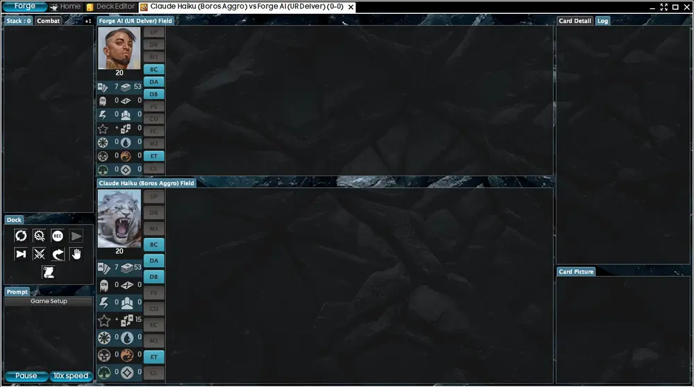
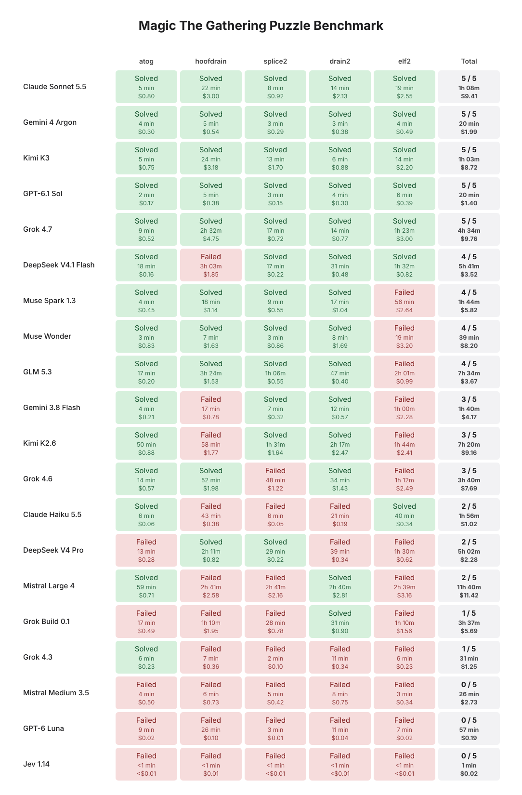

# spike-eval

A harness that lets language models play Magic: The Gathering, and an eval built on top of it.

Models take a player's seat in [Forge](https://github.com/Card-Forge/forge), an open source MTG rules engine, and
play against a person, Forge's built-in AI or another model. The eval is a set of Magic puzzles: the model is handed
a board and has to win that turn. The full story is in the write-up,
[Making a Magic The Gathering Eval](https://folds.ink/posts/mtg-benchmark).


## The harness

A weak harness can make a strong model look weak. The first version of this one parsed the model's replies for
words, showed it part of the board and quietly let Forge's AI make some of its choices, and the models blundered.
This version is built to show a model everything a human player sees and to stay out of its way:

- **Answers are tool calls.** Each decision is answered by filling in a form with fixed fields. Nothing is read out
  of the model's own thinking.
- **Full game state.** Every decision shows what a player could see: both battlefields, the graveyards, how many
  cards are in each hand and library, and the full text of every card. It also lists every legal action the engine
  allows, so an illegal move is impossible.
- **Ids for every object, and a game log.** Each object gets an id like `@67` that stays the same until it changes
  zones. The recent events stay in context, and the model has tools to search and page through the whole log.
- **No hidden fallback to Forge's AI.** If a model fails to make a choice, a default legal option is taken and it is
  marked in the log.
- **Simulation and rules lookup.** In a game the model can preview what an action would do before taking it, without
  seeing the opponent's hand or its own library. Puzzle runs turn the preview off. A rules lookup, off by default,
  lets it search the official rules.



A full game, sped up about 25 times: Claude Haiku in the harness's seat on Boros Aggro against Forge's AI on UR
Delver, about eight minutes of play in twenty seconds. It was played through the Claude Code CLI lane, which is for
local development and never part of a benchmark score.

How each part is built, and why, is in [docs/harness/ARCHITECTURE.md](docs/harness/ARCHITECTURE.md).

## The eval: puzzles

Counting wins makes a poor eval. Magic has a lot of luck in it, and decks beat each other like rock, paper,
scissors, so a win rate says more about the draw and the decks than about the model.

A puzzle takes the luck out. Like a chess puzzle, it gives a board and a goal, usually "win this turn", and the
model either finds the line or it doesn't. The hard puzzles here are long, with many objects in play that may or may
not matter, and a board is in the suite below only if random play and other fixed players all fail it. It is a room
with one door: the goal is clear, and how to get there is not given.

### Results

Twenty models on five of the hardest puzzles, one game each:



Five models solved all five, three solved none, and 58 of the 100 games were solved. Read it as a first comparison
and not a ranking: one game a puzzle cannot separate models that differ by a puzzle or two, the games ran under
several time and token limits, and a few of the failures were games the harness lost or that were stopped early.
[docs/harness/PUZZLE-COMPARISON.md](docs/harness/PUZZLE-COMPARISON.md) has the conditions and those cases. The times
and costs in the chart are from the write-up; the repository records only solved or failed.

The puzzles are in `eval/puzzles/`, grouped into frozen suites in `eval/suites/`. To run a model on one and score it,
after `setup.sh` below (the run stops when the budget is spent, and it needs the same key and consent as a game):

```bash
python3 eval/puzzles/puzzle_solve.py --suite eval/suites/puzzles-hard-gen2-v1.json --split open \
  --model openrouter:openai/gpt-6-luna --memory-tools --budget-usd 1.00 --out runs/puzzles/luna-open
python3 eval/puzzles/puzzle_score.py --suite eval/suites/puzzles-hard-gen2-v1.json --split open runs/puzzles/luna-open
```

The puzzle format and the scoring are in [docs/eval/PUZZLES.md](docs/eval/PUZZLES.md). The repository can also score
full games against Forge's AI ([docs/eval/SCORING.md](docs/eval/SCORING.md)).

## Play against it

You need Java 17+, Maven 3.8.1+, git and Python 3, and an [OpenRouter](https://openrouter.ai) key. `setup.sh` builds
on macOS (Apple silicon), Linux, and Windows in Git Bash, the terminal that comes with
[Git for Windows](https://git-scm.com/download/win): the [`setup`](.github/workflows/setup.yml) workflow, started by
hand, runs `bash setup.sh` and one headless game with no model on each, and passed on all three on 2026-11-10. Intel
Macs and WSL2 should work the same way but have not been run. `setup.sh` names what to install when a tool is missing.

```bash
git clone https://github.com/lumlaolao/spike-eval.git && cd spike-eval
bash setup.sh                                         # fetches and builds Forge, asks for your key
bash play-vs-llm.sh                                   # your Burn against the model on Mardu Energy
bash play-vs-llm.sh --deck elves --vs ur-delver       # pick both decks
bash play-vs-llm.sh --commentary --why                # shows its decisions and reasons as it plays
```

`setup.sh` clones Forge at the pinned commit into `~/code/forge` (about 1 GB; `--forge-dir` for elsewhere), adds the
harness and builds it. `play-vs-llm.sh` finds a Forge built elsewhere by itself; the other commands here look in
`$FORGE_HOME`, then `~/code/forge`, so after `--forge-dir <dir>` run `export FORGE_HOME=<dir>` first. The first run takes about 10 minutes. It then asks for your key and whether games may be sent
to openrouter.ai, and writes both to `secrets.env`, which git ignores. If a key is already set in your shell, setup
asks before using it, and the answer defaults to no. Run it again after a `git pull`.

If you would rather have a coding agent such as Claude Code do the setup, give it this:

```
Clone https://github.com/lumlaolao/spike-eval and run `bash setup.sh` in it. If it reports a missing tool
(Java 17+, Maven 3.8.1+, git, Python 3), install it and run setup again. Setup cannot take my OpenRouter key
through you: once Forge is built, tell me to run `bash setup.sh` again myself in a terminal to enter the key.
Never ask me to paste the key into this chat.
```

`play-vs-llm.sh` opens Forge's window, so it needs a display. On start Forge prints a page of warnings in the
terminal (cards "not assigned to any set", a missing skins directory); they are harmless. Forge fetches each card's
picture from the internet the first time the card is shown. A game costs about $0.02 to $0.05 with the default
model, GPT-6 Luna, and the model may think for minutes on a hard decision. Games against a person are never scored.

### Decks

Decks are plain text files in `eval/decks/`. `--deck burn` means `eval/decks/burn.txt`, and you can also give a path
to a file of your own. The format is the one MTGO and most deck sites export: one card per line, the count and then
the card's exact name, with an optional `Sideboard` line before the sideboard.

```
4 Goblin Guide
4 Lightning Bolt
20 Mountain
Sideboard
2 Smash to Smithereens
```

Besides the `hook-*` test decks, the folder has 52 lists: 36 tournament lists from Standard, Pioneer, Modern, Legacy,
Vintage and Pauper ([eval/decks/SOURCES.md](eval/decks/SOURCES.md) says where each came from) and 16 archetype
decks such as `burn`, `elves` and `ur-delver`. A name has to be spelled the way Forge spells it, accents included.

## Model against Forge's AI

```bash
python3 eval/run_batch.py --seeds 4101 --exploratory --budget-usd 0.40 --deck eval/decks/burn.txt \
  --controller-a llm --controller-b ai \
  --smart-a openrouter:openai/gpt-6-luna --fast-a openrouter:openai/gpt-6-luna \
  --memory-tools --lookahead --out runs/loop/g01
python3 eval/match_review.py runs/loop/g01        # what the harness decided, lost or skipped, and where the time went
```

An `openrouter:` model sends the game state to openrouter.ai. Nothing is sent unless `OPENROUTER_API_KEY` and your
own consent, `OPENROUTER_ALLOW_EGRESS=1`, are set. A game takes 20 to 90 minutes. `run_batch.py` stops at
`--budget-usd`, and `eval/cost_report.py` prices any run. Every setting is in `docs/harness/SETTINGS.md`. Your runs land
in `runs/`; the run directories the documents cite for their numbers are not part of this repository.

## Build and test by hand

`setup.sh` does all of this for you. The Python code uses only the standard library.

```bash
export FORGE_HOME=~/code/forge
git clone https://github.com/Card-Forge/forge.git "$FORGE_HOME" && git -C "$FORGE_HOME" checkout $(cat FORGE_COMMIT)
bash install.sh                                       # copy the overlay in, apply engine-patches/
(cd "$FORGE_HOME" && mvn -q -pl forge-gui-desktop -am install -DskipTests -DskipLaunch4j)   # checkstyle runs here; -o once built
(cd "$FORGE_HOME" && mvn -q -pl forge-gui-desktop -am dependency:build-classpath -Dmdep.outputFile=${FORGE_CP_FILE:-/tmp/forge_cp.txt})
bash eval/harness_acceptance.sh                       # compile, every test, canaries, fake-model games
bash eval/keyword_gauntlet.sh                         # 29 free games over 564 cards
```

Acceptance needs no API key and costs nothing: its games use fixed players or a fake model on your own machine.
It builds into `runs/harness-acceptance/<ts>/` and never touches the checkout.

## Contributing

Changes land through pull requests; [CONTRIBUTING.md](CONTRIBUTING.md) and [docs/STANDARDS.md](docs/STANDARDS.md)
say how. To report a security problem, see [SECURITY.md](.github/SECURITY.md).

## License

GPL-3.0-or-later ([LICENSE](LICENSE)), like Forge, into which the harness is compiled. [NOTICE.md](NOTICE.md) says
what is and is not in this repository and credits every source. This project is not affiliated with the Forge project.

Unofficial Fan Content permitted under the Fan Content Policy. Not approved/endorsed by Wizards. Portions of the
materials used are property of Wizards of the Coast. ©Wizards of the Coast LLC.
