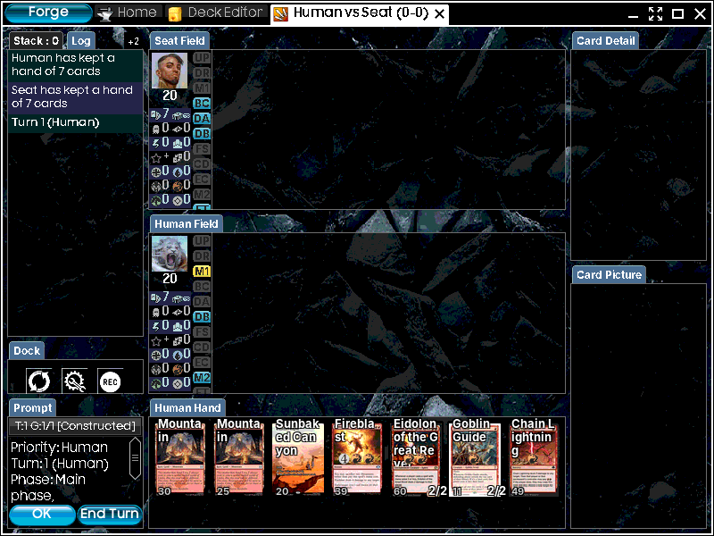

# mtg-forge-llm-agent

Language models play full games of Magic: The Gathering inside [Forge](https://github.com/Card-Forge/forge), the
open-source rules engine, and the games are scored as a benchmark. This repository holds only the overlay that drops
into a Forge checkout; it does not redistribute Forge (GPL).

- **How a model plays:** `PlayerControllerLLM` (in `forge-overlay/.../spike/LlmSpikeGui.java`) answers every decision
  the engine asks a player: 89 decision hooks and 44 ways to play a card, each proven by a test. The engine checks
  every option, so an illegal move is impossible. The model answers by calling one `answer` function and may look
  things up with native tool calls (card text, its archive, a preview of an option). Forge's own AI never decides for
  the seat (`[TALLY] ... ai=0`).
- **What the model sees:** the faithful observation (`SeatObservation.java`): the state from the engine, Forge's game
  log, the opponent's cards it has seen, and its own notes, each block labelled by its source.
- **The benchmark:** STR-AI (win rate against Forge's AI on frozen panels), STR-HELDOUT (the same on held-out seeds),
  PUZ (frozen puzzle suites, each attempt judged by Forge's own puzzle mode). `eval/EVAL-DESIGN.md`,
  `eval/SCORING.md`, `eval/PUZZLES.md`.
- **Status:** the gate records are in `docs/harness/ACCEPTANCE.md`, what each real game found in
  `docs/harness/GAME-LOOP-LOG.md`, and the open work and what waits on the owner in `docs/harness/WORK-PLAN.md`.

## Quick start: play the model on your own computer

```bash
git clone https://github.com/SeanCThomas0/mtg-forge-llm-agent.git && cd mtg-forge-llm-agent   # or unzip a copy, cd in
bash setup.sh          # Forge at the tested commit, these changes on top, the build, your OpenRouter key
bash play-vs-llm.sh    # you against GPT-6 Luna in Forge's window
```

`setup.sh` needs Java 17 or newer, Maven 3.8.1 or newer, git and Python 3, and says how to install any that is missing (macOS or
Linux; on Windows, WSL2). It fetches Forge at exactly `FORGE_COMMIT` (shallow, about 1 GB) into `~/code/forge`
(`--forge-dir` for elsewhere), lays `forge-overlay/` on it, and builds it: about 10 minutes the first time, while
Maven downloads Forge's libraries. Last it asks for your OpenRouter key and whether games may be sent to
openrouter.ai, and writes both to `secrets.env`, which only you can read and git ignores. After a `git pull`, run it
again: it moves its own Forge checkout to a new pin and rebuilds.

To hand someone a copy, zip only what git tracks, so your `secrets.env` (your key and your consent) stays behind:
`git archive --format=zip --prefix=mtg-forge-llm-agent/ -o ../mtg-forge-llm-agent.zip HEAD -- . ":(exclude)runs"
":(exclude)datasets"`. They add their own key when `setup.sh` asks.

## Build and check

Requires JDK 17, Maven 3.8.1 or newer, and Python 3 (stdlib only).

```bash
git clone https://github.com/Card-Forge/forge.git /root/forge && git -C /root/forge checkout $(cat FORGE_COMMIT)
FORGE_HOME=/root/forge bash install.sh                                   # copy the overlay in
(cd /root/forge && mvn -q -pl forge-gui-desktop -am install -o -DskipTests) # build (checkstyle runs here)
FORGE_HOME=/root/forge bash eval/harness_acceptance.sh                   # compile, every test, canaries, fake-model games
bash eval/keyword_gauntlet.sh                                            # 28 free games over 552 cards
```

`eval/harness_acceptance.sh` never touches the checkout (it builds into `runs/harness-acceptance/<ts>/`). Its zero-model
canaries are bit-reproducible: the seed-42 floor mirror wins A in 108 turns, the random mirror A in 55 (Linux pins,
`eval/harness_acceptance.expected`).

## Play against the model yourself

Sit across the table from a language model in Forge's own match screen: you click your cards, it plays its seat
under the benchmark's pilot condition (`eval/suites/panels-v1.json`: the same prompt, tools and `answer` call as its
scored games, seeing only what its seat may see).

```bash
bash play-vs-llm.sh                                   # your Burn against GPT-6 Luna on Mardu Energy
bash play-vs-llm.sh --deck elves --vs ur-delver       # any eval/decks/<name>.txt, or a path to a decklist
CLAUDE_CLI_SEAT=1 bash play-vs-llm.sh --model claude-cli:opus   # Claude Code on your own subscription
bash play-vs-llm.sh --commentary --why                # each model decision and its reason, live in the terminal
```



It needs `bash setup.sh` once (or your own built checkout in `FORGE_HOME`) and a display. An `openrouter:` model needs
your egress consent (`OPENROUTER_ALLOW_EGRESS=1` in `secrets.env`; the script reads it and never sets it); a Luna
game costs about $0.02 to $0.05. The model may think for minutes on a hard decision, and the screen waits for it.
Its decisions, replies and requests are kept under `runs/human/<time>/`; `--commentary` prints each of its decisions
as it makes them (`eval/play_commentary.py`, which also reads a finished game), and `--why` its reasons. Both show its
hidden choices and `--why` names its hand: for watching or streaming, not a fair game. Games against a person are
never part of a benchmark score (`docs/harness/ARCHITECTURE.md`, section 11).

## Play a game

```bash
python3 eval/run_batch.py --seeds 4101 --exploratory --budget-usd 0.40 --deck eval/decks/burn.txt \
  --controller-a llm --controller-b ai \
  --smart-a openrouter:openai/gpt-6-luna --fast-a openrouter:openai/gpt-6-luna \
  --memory-tools --lookahead --out runs/loop/g01
python3 eval/match_review.py runs/loop/g01        # what the harness decided, lost, skipped; where the time went
```

An `openrouter:` model sends the game state to openrouter.ai: set `OPENROUTER_API_KEY` and, as your own consent,
`OPENROUTER_ALLOW_EGRESS=1` (the factory refuses without it). A Luna game costs $0.02 to $0.05 and takes 20 to 90
minutes. `run_batch.py` pins the condition, stamps provenance, resumes, retries a crashed game once, and stops at
`--budget-usd`. `eval/cost_report.py` prices any run.

The GUI (`bash /root/forge/run-llm-spike.sh`, each model seat's `SMART_MODEL` / `FAST_MODEL` named: there is no
default model) shows a spectator match; `RECORD=1 RECORD_OUT=game.mp4 RECORD_FPS=8`
captures the window to H.264 in-process (no screen-recording permission; `ffmpeg` on `PATH`). Watchdog GUI runs with
`( sleep N; pkill -INT -f LlmSpikeGui ) &` (SIGINT, so the recorder finalizes the file). GUI matches are best of
three; only the headless runner writes the game line.

## Settings (env vars; `run_batch.py` sets these from its flags)

| Var | Default | What |
|---|---|---|
| `SMART_MODEL` / `FAST_MODEL`, `_A` / `_B` | none: a model seat that names no model is refused (the JVM, `run_batch.py`) | model per tier and seat: `openrouter:<model>`, `jev:<model>` (a decision model), or `claude-cli:<model>` (Claude Code in print mode, answering by structured output: a development lane, only with `CLAUDE_CLI_SEAT=1`). A bare Claude name (`haiku`, `opus`), the retired text lane, is refused |
| `CONTROLLER_A/B` | `llm` | `random` (uniform over the same menus), `floor` (fixed legal fallbacks), `ai` (Forge's AI), `human` (a person on Forge's match screen; GUI only, one seat, `play-vs-llm.sh`) |
| `CONTEXT_PROFILE` | `v4-faithful` (`run_batch.py`); `v1-compat` if unset in a raw launch | the observation shape; `v1-compat` (coaching, a turn cap) runs only as a named arm |
| `MEMORY_TOOLS` / `LOOKAHEAD` / `RULES_TOOL` | 0 | the lookups, the `simulate` preview and attack outlook, the rules lookup (needs `MEMORY_TOOLS=1` too) |
| `NATIVE_TOOLS` / `ANSWER_TOOL` | 1 | tool calls for lookups and answers; 0 is the text protocol, for measurement only |
| `ONE_TIER` | 1 | every decision on the reasoning tier; `run_batch.py --two-tier` is a measured arm |
| `MULLIGAN_HEURISTIC` / `SKIP_HEURISTICS` / `PLAN_EXECUTE` | 0 | harness shortcuts, measurement arms only |
| `GAME_SEED`, `SWAP_SEATS` | random, 0 | seeded shuffles; `1` seats identity B first (the paired flip) |
| `DECK_A/B`, `DECK_A_NAME/B_NAME`, `PLAN_A/B` | eval decks | decklists, seat labels, deck framing (`PLAN_A=""` for none) |
| `EVAL_OUT` | off | directory for the per-decision and game JSONL |
| `GAME_CAP_MS` | 3 h headless | wall-clock cap; a capped game is invalid, never a draw |
| `SMART_BUDGET` / `FAST_BUDGET` | 10000 | per-game call caps: loop guards, not decision limits (`docs/harness/MODEL-LIMITS.md`) |
| `OPENROUTER_BASE_URL`, `OPENROUTER_TIMEOUT_MS`, `OPENROUTER_IDLE_MS` | openrouter.ai, per model, 90000 | endpoint (recorded on the game line), call deadline, how long a silent connection may stall. A `jev:` decision-model seat posts to the same base's `/alpha/decisions` (its `/v1` replaced) with a 120000 ms deadline unless `OPENROUTER_TIMEOUT_MS` is set |
| `OPENROUTER_MODEL_CFG` | none | JSON override of the per-model config (`ModelCfg`: max tokens, timeouts, reasoning effort) |
| `CLAUDE_CLI_SEAT` | unset | `1` chooses a model seat on the Claude CLI (`claude-cli:`): Claude Code on the operator's own Claude subscription, for local development only and never part of a benchmark score (owner, 2026-10-24). Without it the JVM, `run_batch.py` and `puzzle_solve.py` refuse the spec; cited mode, `--panel` and `panel_score.py` refuse it always, and its games and puzzle rows are stamped `dev_lane` |
| `CLAUDE_CLI_ALLOW_API_KEY` | unset | `1` lets a `claude-cli:` seat's CLI log in with `ANTHROPIC_API_KEY` / `ANTHROPIC_AUTH_TOKEN`; unset, those are dropped from its environment and it uses the subscription login |
| `CLAUDE_BIN` | `claude` | the Claude Code CLI a `claude-cli:` seat runs |
| `CLAUDE_BRIDGE_EFFORT`, `_SMART` / `_FAST` | unset (the CLI's default) | the CLI's `--effort` per tier, stamped `claude_effort_smart` / `_fast`; never read from Claude Code's own `CLAUDE_EFFORT`. For a `claude-cli:` seat the drivers pin it from `--claude-cli-effort` |
| `CLAUDE_CLI_THINKING_TOKENS` | unset (the CLI's default, stamped "cli-default") | a `claude-cli:` seat's thinking budget, set in the child as `MAX_THINKING_TOKENS` (the child never inherits that variable); pinned by the drivers from `--claude-cli-thinking-tokens`, stamped `claude_cli_thinking_tokens_a` / `_b` |
| `CLAUDE_DEADLINE_MS` | per model (`ModelCfg`) | a CLI call's deadline; past it the process is killed and the decision has no answer |

## Operations

- **Parallel games:** openrouter games 6 to 10 JVMs (RAM-bound, about 1 GB each, counted across all batches); floor 4
  to 8; Claude CLI specs 1. Never rebuild the checkout while a game runs. `eval/CONCURRENCY.md`.
- **A capped game** grants in-flight asks a grace window sized to the slowest model timeout before the JVM exits;
  `run_batch.py`'s backstop stays wider than cap plus grace.
- **The shadow labeller** (`SHADOW_AI`) has its own two-gate check: `bash eval/shadow_canary.sh`.
- `secrets.env` (git-ignored; template `secrets.env.example`) is read by the eval drivers.

## Lessons the code is built on

1. **Pass priority with `null`, never an empty list.** An empty list means "play nothing, then ask again", and the
   engine's priority loop spins 999 times.
2. **Constrain the model to the engine's legal list,** and offer only what can be paid: a count, mode or target the
   cast cannot pay fails the whole cast.
3. **Answers are tool calls, never text.** A free-form reply that reasoned about a creature it decided not to use was
   read as an attack with it; text grammars refused 30 of 43 tool requests for their form. Zero text parsing.
4. **The AI cast path does no targeting.** Set engine-validated targets on the chosen ability before returning it, or
   the cast fizzles.
5. **Never fall back to Forge's AI.** A failure takes a fixed legal option, recorded; Forge's AI quietly made
   load-bearing calls before.
6. **No model ask while pricing.** Building a prompt prices the hand; a hook asked from there builds another prompt,
   forever. The guard is saved and restored, never cleared.
7. **Every number reports its floor.** A replay match of 88% was 10 points over doing nothing.

## Where the documents are

| Document | What |
|---|---|
| `CLAUDE.md`, `.claude/rules/`, `.claude/skills/` | instructions for agents working here |
| `docs/STANDARDS.md` | the standards the review skills enforce |
| `docs/harness/ARCHITECTURE.md` | every part of the harness and why it is built that way |
| `docs/harness/WORK-PLAN.md`, `REVIEW-2026-10-16.md` | open work and its record |
| `docs/harness/GAME-LOOP-LOG.md` | what each real game found |
| `docs/harness/ACCEPTANCE.md`, `GOLDEN-CHECKS.md`, `VERSIONS.md` | gate records, surface coverage, version stamps |
| `docs/harness/PROMPT-CRAFT.md`, `PROMPT-AUDIT.md`, `MODEL-LIMITS.md` | how the seat's prompts and tools are written |
| `docs/harness/INDEX.md` | every document under `docs/harness/`, current or historical |
| `eval/README.md`, `EVAL-DESIGN.md`, `SCORING.md`, `PUZZLES.md` | the eval |
