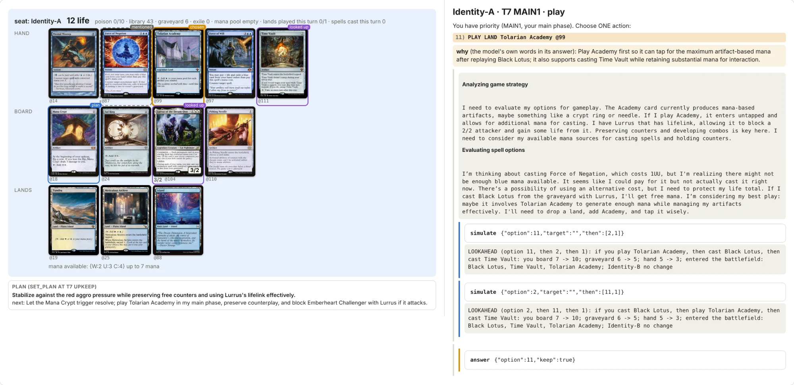

# spike-eval

Language models play full games of Magic: The Gathering inside [Forge](https://github.com/Card-Forge/forge), the
open-source rules engine, and the games are scored as a benchmark. This repository is the harness that drops into a
Forge checkout, plus diffs to four Forge files (`engine-patches/`). Forge itself is not included; `setup.sh` fetches
it. GPL-3.0-or-later, like Forge: see [License](#license).

- **How a model plays.** `PlayerControllerLLM` (`forge-overlay/.../spike/LlmSpikeGui.java`) answers every decision the
  engine asks a player: 89 decision hooks and 44 ways to play a card, each with a test. The engine checks every
  option, so an illegal move is impossible. The model answers by calling one `answer` function and can look things up
  with tool calls (card text, its archive, a preview of an option). Forge's own AI never decides for the seat.
- **What the model sees.** The state from the engine, Forge's game log, the opponent's cards it has seen, and its own
  notes, each block labelled by its source (`SeatObservation.java`).
- **The benchmark.** STR-AI (win rate against Forge's AI on frozen panels), STR-HELDOUT (the same on held-out seeds)
  and PUZ (frozen puzzle suites, judged by Forge's puzzle mode). Design: `docs/eval/EVAL-DESIGN.md`, `docs/eval/SCORING.md`,
  `docs/eval/PUZZLES.md`.



## Play against the model

```bash
git clone https://github.com/SeanCThomas0/spike-eval.git && cd spike-eval
bash setup.sh                                         # Forge at the pinned commit, the harness on top, the build, your key
bash play-vs-llm.sh                                   # your Burn against GPT-6 Luna on Mardu Energy, in Forge's window
bash play-vs-llm.sh --deck elves --vs ur-delver       # any eval/decks/<name>.txt, or a path to a decklist
bash play-vs-llm.sh --commentary --why                # its decisions and reasons live in the terminal (not a fair game)
```

`setup.sh` needs Java 17+, Maven 3.8.1+, git and Python 3 (macOS or Linux; WSL2 on Windows) and says how to install
any that is missing. It clones Forge at `FORGE_COMMIT` into `~/code/forge` (shallow, about 1 GB; `--forge-dir` for
elsewhere), applies the overlay and patches, and builds, about 10 minutes the first time. It then asks for your
OpenRouter key and whether games may be sent to openrouter.ai, and writes both to `secrets.env` (git-ignored). After a
`git pull`, run it again: it moves its Forge checkout to the new pin and rebuilds.

`play-vs-llm.sh` needs a display and that build (or your own built checkout in `FORGE_HOME`). The model plays under
the benchmark's own condition: the same prompt, tools and `answer` call as its scored games, seeing only what its
seat may see. A game costs about $0.02 to $0.05, and the model may think for minutes on a hard decision. Its
decisions, replies and requests land in `runs/human/<time>/`. Games against a person are never scored.

## Play and record a game

```bash
python3 eval/run_batch.py --seeds 4101 --exploratory --budget-usd 0.40 --deck eval/decks/burn.txt \
  --controller-a llm --controller-b ai \
  --smart-a openrouter:openai/gpt-6-luna --fast-a openrouter:openai/gpt-6-luna \
  --memory-tools --lookahead --out runs/loop/g01
python3 eval/match_review.py runs/loop/g01        # what the harness decided, lost, skipped; where the time went
```

An `openrouter:` model sends the game state to openrouter.ai, so `OPENROUTER_API_KEY` and your own consent,
`OPENROUTER_ALLOW_EGRESS=1`, must be set (the factory refuses without it). A Luna game takes 20 to 90 minutes.
`run_batch.py` pins the condition, stamps provenance, resumes, retries a crashed game once and stops at
`--budget-usd`; `eval/cost_report.py` prices any run. Every setting: `docs/harness/SETTINGS.md`.

## Build and check

`setup.sh` does all of this. By hand (Python 3 is stdlib only):

```bash
export FORGE_HOME=~/code/forge
git clone https://github.com/Card-Forge/forge.git "$FORGE_HOME" && git -C "$FORGE_HOME" checkout $(cat FORGE_COMMIT)
bash install.sh                                       # copy the overlay in, apply engine-patches/
(cd "$FORGE_HOME" && mvn -q -pl forge-gui-desktop -am install -DskipTests)    # checkstyle runs here; -o once built
(cd "$FORGE_HOME" && mvn -q -pl forge-gui-desktop -am dependency:build-classpath -Dmdep.outputFile=${FORGE_CP_FILE:-/tmp/forge_cp.txt})
bash eval/harness_acceptance.sh                       # compile, every test, canaries, fake-model games
bash eval/keyword_gauntlet.sh                         # 29 free games over 565 cards
```

Acceptance builds into `runs/harness-acceptance/<ts>/` and never touches the checkout. Its zero-model canaries are
bit-reproducible and pinned in `eval/harness_acceptance.expected` (`docs/harness/ARCHITECTURE.md`, section 11).

To hand someone a copy without your `secrets.env`, zip only what git tracks:

```bash
git archive --format=zip --prefix=spike-eval/ -o ../spike-eval.zip HEAD -- . ":(exclude)runs" ":(exclude)datasets"
```

## Documents

| Document | What |
|---|---|
| `CLAUDE.md`, `.claude/rules/`, `.claude/skills/` | instructions for agents working here |
| `docs/STANDARDS.md` | the standards the review skills enforce |
| `docs/harness/ARCHITECTURE.md` | every part of the harness and why it is built that way |
| `docs/harness/SETTINGS.md` | the variables that set a game's condition and models, the GUI and recording, operations |
| `docs/harness/LESSONS.md` | the lessons the code is built on |
| `docs/harness/WORK-PLAN.md`, `GAME-LOOP-LOG.md` | open work and what waits on the owner; what each real game found |
| `docs/harness/ACCEPTANCE.md`, `GOLDEN-CHECKS.md`, `VERSIONS.md` | gate records, surface coverage, version stamps |
| `docs/harness/PROMPT-CRAFT.md`, `PROMPT-AUDIT.md`, `MODEL-LIMITS.md` | how the seat's prompts and tools are written |
| `docs/harness/INDEX.md` | every document under `docs/harness/`, current or historical |
| `eval/README.md`, `EVAL-DESIGN.md`, `SCORING.md`, `PUZZLES.md` | the eval |

The documents cite run directories (`runs/loop/g26`, `runs/c3/...`) for every number. Those recorded games (full
model transcripts, about 300 MB) are not part of this repository; `runs/` is where your own runs land.

## License

GPL-3.0-or-later ([LICENSE](LICENSE)), like [Forge](https://github.com/Card-Forge/forge), into which the harness is
compiled. [NOTICE.md](NOTICE.md) says what is and is not in this repository and credits every source.

Unofficial Fan Content permitted under the Fan Content Policy. Not approved/endorsed by Wizards. Portions of the
materials used are property of Wizards of the Coast. ©Wizards of the Coast LLC.
